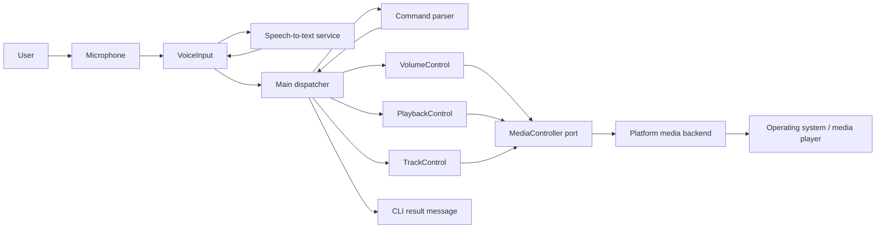
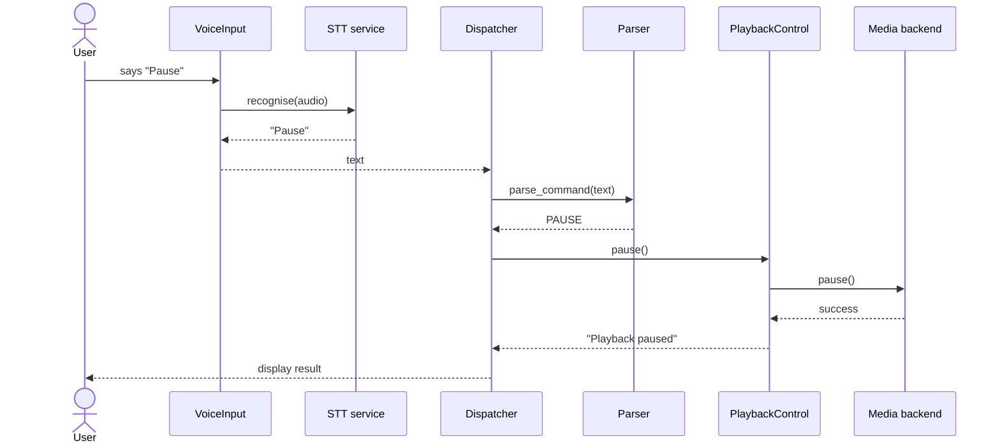
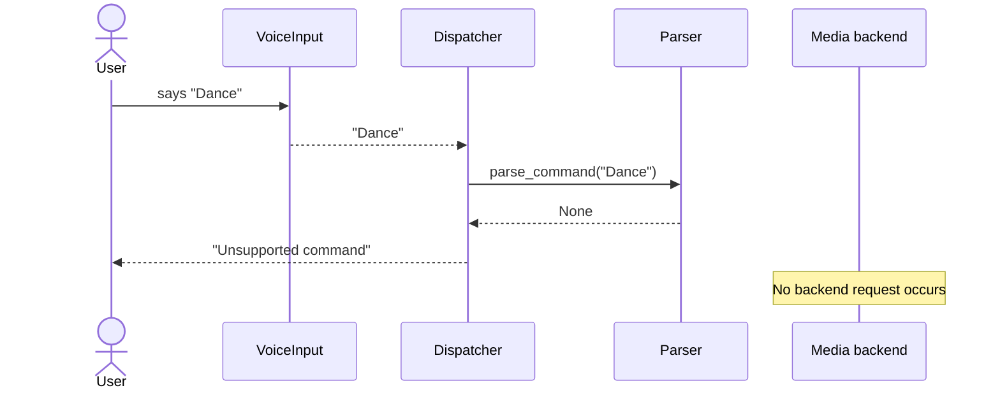

# Software Architecture and Design Specification

**Project:** Voice Assistant for Multimedia Controls  
**Version:** 1.0-draft  
**Date:** 12 October 2026  
**Status:** Draft—pending team and instructor approval  
**Related documents:** SRS v1.0-draft; Test Plan v1.0-draft

## 1. Introduction

### 1.1 Purpose and scope

This document describes the architecture and detailed design of the voice-controlled multimedia assistant. It covers its Python modules, component interactions, interfaces, errors, and security design. It does not prescribe one permanent operating-system or media-player implementation.

### 1.2 Stakeholders

Users need quick, reliable hands-free controls. Developers need independent modules and test seams. Testers need deterministic fakes without microphones or media hardware. The instructor needs clear traceability to submitted requirements.

## 2. Architecture

### 2.1 Goals and constraints

- Keep voice capture, parsing, feature logic, and OS/media calls independently testable.
- Make the backend replaceable so laptop and ESP/Raspberry Pi choices do not alter feature modules.
- Fail safely for unsupported input, absent hardware, STT failures, and backend failures.
- Keep the first version small: one spoken command per cycle and a command-line outcome.

### 2.2 Architectural pattern

The project uses a **layered, ports-and-adapters architecture**. The main dispatcher coordinates the application layer; voice input and feature modules are application services; `MediaController` is an outbound port; the platform-specific backend is its adapter. This separates policy from device integration and supports mock-based tests.

### 2.3 Component diagram

### 2.4 Component descriptions

| Component | Responsibility | Key dependencies |
| --- | --- | --- |
| `voice_input.VoiceInput` | Capture one phrase, call STT, return text or safe no-input result. | Microphone library, recognizer |
| `command_parser.parse_command` | Normalise text and map allowed aliases to `Command`. | `common.Command` |
| `main` dispatcher | Obtain text, parse it, route one recognised command, print result. | VoiceInput, parser, feature modules |
| `volume.VolumeControl` | Request volume up/down and translate backend failure to a result. | `MediaController` |
| `playback.PlaybackControl` | Request play/pause/resume and retain last successful state. | `MediaController` |
| `track.TrackControl` | Request next/previous track. | `MediaController` |
| `common.MediaController` | Defines the device-independent outbound port. | Python ABC |
| `media_backend` | Implements the port for the selected platform. | OS/media API |

### 2.5 Technology choices

Python 3.12+ is used with pytest for tests, SpeechRecognition (or an approved substitute) for voice capture, and Flake8/Bandit for quality checks. A concrete backend will be chosen for the team’s actual target platform and isolated behind the existing interface.

### 2.6 Requirement traceability

| Requirement group | Architecture/design element |
| --- | --- |
| FR-01 to FR-04 | `VoiceInput`, recognizer/microphone adapter |
| FR-05, FR-13, SR-03 | Parser allow-list and normalisation |
| FR-06 to FR-07 | `VolumeControl` and `MediaController.volume_*` |
| FR-08 to FR-10 | `PlaybackControl` and `MediaController.play/pause/resume` |
| FR-11 to FR-12 | `TrackControl` and `MediaController.next_track/previous_track` |
| FR-14 | Dispatcher routing table or match statement |
| FR-15, NFR-02, SR-04 | Boundary exception handling and result messages |
| NFR-03 | `MediaController` port / platform adapter |
| NFR-04, NFR-05, SR-05 | GitHub Actions quality workflow |
| SR-01, SR-02 | No persistence/logging of audio or transcripts |

### 2.7 Security architecture

| Threat | Control |
| --- | --- |
| Unexpected spoken/text input triggers an unsafe action | Parser uses a fixed allow-list and returns no command for all other input. |
| STT service or microphone fails | Voice input catches expected failures and returns a safe no-input result. |
| Backend failure crashes application | Feature modules catch backend exceptions and return controlled failure messages. |
| Audio/transcript privacy exposure | No normal-operation persistence; logs exclude audio, transcripts, secrets, and device identifiers. |
| Vulnerable or low-quality source reaches main | Pull-request CI runs pytest, Flake8, and Bandit. |

## 3. Detailed design

### 3.1 Core data model

`Command` is an enum with `VOLUME_UP`, `VOLUME_DOWN`, `PLAY`, `PAUSE`, `RESUME`, `NEXT`, and `PREVIOUS`. `PlaybackState` is an enum with `STOPPED`, `PLAYING`, and `PAUSED`. No database is required for version 1.

### 3.2 API design

| Component | Operation | Input | Output / errors |
| --- | --- | --- | --- |
| VoiceInput | `capture()` | None | `str` recognised text, or `None` for timeout, unrecognised speech, blank text, service/device failure. |
| Parser | `parse_command(text)` | `str | None` | `Command | None`; no exception for unsupported/blank input. |
| Dispatcher | `dispatch(command)` | `Command` | User-facing success/failure message. |
| VolumeControl | `increase()`, `decrease()` | None | Success/failure message; invokes matching port method. |
| PlaybackControl | `play()`, `pause()`, `resume()` | None | Success/failure message; changes state only after success. |
| TrackControl | `next()`, `previous()` | None | Success/failure message. |
| MediaController | seven abstract methods | None | Raises platform exception only to its caller; feature module contains it. |

### 3.3 Sequence diagram: supported playback command

### 3.4 Sequence diagram: unsupported/failure command

### 3.5 Dispatcher design

The dispatcher owns no OS-specific logic. Its algorithm is:

1. Call `VoiceInput.capture()`.
2. If the result is absent, show an input-unavailable/try-again message and continue.
3. Pass text to `parse_command()`.
4. If no `Command` is returned, show `Unsupported command` and do not call the backend.
5. Route exactly one command to its feature module, show that module’s result, and continue for the next command.

### 3.6 Error handling and logging

| Condition | Handling | User message |
| --- | --- | --- |
| Silence/recognition timeout | Return no text; do not raise. | `No command heard. Try again.` |
| Unknown speech/STT unavailable | Return no text; do not expose provider details. | `Could not recognise a command. Try again.` |
| Unsupported text | Do not invoke a feature/backend. | `Unsupported command.` |
| Backend operation fails | Catch exception at feature boundary; preserve valid state. | `Playback/volume/track action failed.` |
| Programmer/configuration error | Log safe technical context for developers; fail test/CI. | Not exposed as sensitive implementation detail. |

Logs must not contain audio, raw transcripts, credentials, or device identifiers. Error messages presented to the user must be concise and avoid stack traces.

### 3.7 Open issues and next steps

- Select and implement the actual OS/media-player adapter.
- Implement `TrackControl` and the dispatcher loop.
- Resolve and merge the voice-input PR after dependency/device-failure review.
- Add GitHub Actions for test, lint, and Bandit checks.
- Validate the selected backend with physical microphone/media-player system testing.

## 4. Appendices

### 4.1 Tools

Python, pytest, unittest.mock, Flake8, Bandit, GitHub Actions, and Mermaid/PlantUML-compatible diagram tooling.

### 4.2 Approval

This draft requires review and sign-off by all team members and the course instructor before formal submission.

