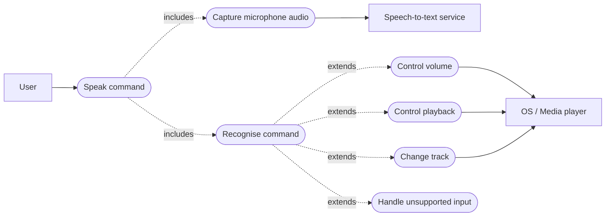

# Software Requirements Specification

**Project:** Voice Assistant for Multimedia Controls  
**Version:** 1.0-draft  
**Date:** 12 October 2026  
**Status:** Draft—pending team and instructor approval  
**Authors:** SE_MINIPROJECT team

## Revision history

| Version | Date | Change summary |
| --- | --- | --- |
| 1.0-draft | 12 October 2026 | Initial SRS for the mini-project |

## 1. Introduction

### 1.1 Purpose

This SRS defines the functional, quality, interface, and security requirements for a Python voice assistant that controls multimedia playback on a laptop or supported media device.

### 1.2 Scope

The product receives one spoken command through a microphone, converts it to text, identifies a supported intent, and requests the matching media action. The first release supports volume up/down, play, pause, resume, next track, and previous track. Unsupported or unrecognised speech is handled without terminating the application.

The first release excludes user accounts, playlists, a graphical interface, cloud storage, and media-player implementation internals.

### 1.3 Audience

This document is for the project team, test reviewers, course instructor, and future maintainers.

### 1.4 Definitions

| Term | Meaning |
| --- | --- |
| STT | Speech-to-text conversion of microphone audio into text. |
| Media backend | Adapter that sends an action to the operating system or media player. |
| Command | A recognised supported intent, represented by the `Command` enum. |
| RTM | Requirements Traceability Matrix. |

## 2. Overall description

### 2.1 Product perspective

The system is a small layered application. A voice-input component supplies text, a command parser maps text to a command, a dispatcher selects a feature module, and feature modules call a media backend through the shared `MediaController` interface.

### 2.2 User class

The primary user is a laptop or device user who needs hands-free basic media control. The user is expected to speak one short English command at a time.

### 2.3 Operating environment

Python 3.12+ runs on a laptop or supported hardware platform with a microphone, internet access when a cloud STT provider is used, and a supported media-control mechanism. Unit tests must run without microphone hardware.

### 2.4 Constraints and assumptions

- Commands are English phrases from the supported-command list.
- The host OS/media player must expose controls that the selected backend can invoke.
- Audio recognition may be unavailable because of silence, no microphone, or network/service failure.
- The application does not store audio recordings, credentials, or personal data.

## 3. External interface requirements

### 3.1 User interface

Version 1 uses a command-line interface. It shall show a concise outcome message after each captured command, such as `Playback paused` or `Unsupported command`.

### 3.2 Hardware interface

The voice-input component shall use the host’s default microphone through a microphone library. The application shall still be testable through injected fake microphone and recognizer objects.

### 3.3 Software interfaces

| Interface | Purpose |
| --- | --- |
| Speech-recognition provider | Converts a captured phrase to text. |
| `MediaController` | Abstract API used by feature modules to request volume, playback, and track actions. |
| OS/media-player adapter | Concrete implementation of `MediaController`; platform-specific and replaceable. |

## 4. System features and functional requirements

Priority meanings: **High** is required for the first working release; **Medium** improves robustness or usability.

| ID | Requirement | Priority | Acceptance criterion |
| --- | --- | --- | --- |
| FR-01 | The system shall open the configured microphone and capture one spoken phrase. | High | A valid fake or physical microphone produces one audio input attempt. |
| FR-02 | The system shall send captured audio to the configured STT recognizer and obtain text when recognition succeeds. | High | A recognizer result `Volume Up` is returned as text. |
| FR-03 | The system shall stop waiting for speech after a configurable positive timeout. | High | A timeout returns control to the application without an uncaught exception. |
| FR-04 | The system shall return no command when audio is silent, unintelligible, blank, or the STT service is unavailable. | High | Each condition yields a safe outcome and the process remains running. |
| FR-05 | The system shall normalise recognised text by ignoring case, punctuation, and repeated whitespace. | High | `  Volume Up! ` maps to `VOLUME_UP`. |
| FR-06 | The system shall recognise `Volume Up` and `Increase Volume`. | High | Either phrase dispatches one volume-increase request. |
| FR-07 | The system shall recognise `Volume Down` and `Decrease Volume`. | High | Either phrase dispatches one volume-decrease request. |
| FR-08 | The system shall recognise `Play`. | High | The backend receives exactly one `play()` request. |
| FR-09 | The system shall recognise `Pause`. | High | The backend receives exactly one `pause()` request. |
| FR-10 | The system shall recognise `Resume`. | High | The backend receives exactly one `resume()` request. |
| FR-11 | The system shall recognise `Next` and `Next Track`. | High | Either phrase dispatches one `next_track()` request. |
| FR-12 | The system shall recognise `Previous` and `Previous Track`. | High | Either phrase dispatches one `previous_track()` request. |
| FR-13 | The system shall display a simple safe message and make no backend request for an unsupported command. | High | `dance` reports unsupported input without an exception. |
| FR-14 | The dispatcher shall route each recognised command to exactly one matching feature operation. | High | A parameterised integration test verifies one route per command. |
| FR-15 | The system shall display a clear failure message and remain available when a backend action fails. | Medium | A backend exception produces a failure message and a later command can be handled. |

## 5. Non-functional requirements

| ID | Requirement | Measure / acceptance criterion |
| --- | --- | --- |
| NFR-01 | The command-processing path after text recognition shall complete within 2 seconds for 95% of 100 test runs on the target laptop. | Timed automated test or recorded test report. |
| NFR-02 | The application shall recover from an unsupported command, recognition failure, or backend exception without process termination. | 100% of applicable resilience tests pass. |
| NFR-03 | Each feature module shall depend on the `MediaController` interface rather than direct OS-specific calls. | Code review finds no OS media call outside the backend module. |
| NFR-04 | The project shall provide automated unit tests for every FR and run them in GitHub Actions on pull requests. | CI succeeds; RTM has a test reference for every FR. |
| NFR-05 | The source shall pass configured static-analysis and security checks with no high-severity findings. | `flake8` and `bandit` return success in CI. |
| NFR-06 | The user-facing result of a handled command shall be concise and understandable. | Manual review confirms outcome or failure message for every command. |

### 5.1 Security objectives

| ID | Objective |
| --- | --- |
| SO-01 | Protect user privacy by minimising audio/data retention and avoiding sensitive data in logs. |
| SO-02 | Preserve control integrity so malformed input or a failed external service cannot trigger an unintended media action or crash the application. |

### 5.2 Security requirements

| ID | Requirement | Acceptance criterion |
| --- | --- | --- |
| SR-01 | The system shall not persist microphone audio or recognised text after processing unless the user explicitly enables diagnostic logging. | Repository inspection finds no audio/text persistence in normal operation. |
| SR-02 | The system shall not log credentials, access tokens, raw audio, or device identifiers. | Log review and security test show no sensitive values. |
| SR-03 | The parser shall use an allow-list of supported command aliases and reject every other text value. | Parser tests show unknown strings return no command. |
| SR-04 | The voice-input and dispatch paths shall catch expected recognizer/backend failures and return a safe result. | Failure-injection tests pass without a traceback. |
| SR-05 | Dependencies shall be pinned in `requirements.txt` and scanned with Bandit in CI before merge. | CI workflow installs the declared versions and runs Bandit. |

## 6. Quality attributes and acceptance

The release is acceptable when all High-priority FRs are implemented and tested, all RTM rows have a passing test, the response target is measured, there are no open critical defects, and the security-validation checks pass.

## 7. UML use-case diagram

## 8. Requirements traceability matrix

| Requirement | Design component | Test case | Status |
| --- | --- | --- | --- |
| FR-01–FR-04 | VoiceInput | TC-01, TC-02, TC-03 | Planned |
| FR-05 | Command parser | TC-04 | Implemented |
| FR-06–FR-07 | Parser, VolumeControl, dispatcher | TC-05 | Partially implemented |
| FR-08–FR-10 | Parser, PlaybackControl, dispatcher | TC-06 | Partially implemented |
| FR-11–FR-12 | Parser, TrackControl, dispatcher | TC-07 | Planned |
| FR-13 | Command parser, CLI | TC-08 | Partially implemented |
| FR-14 | Main dispatcher | TC-09 | Planned |
| FR-15 | Feature modules, backend | TC-10 | Partially implemented |
| NFR-01 | Performance test | TC-11 | Planned |
| NFR-02 | Resilience tests | TC-03, TC-10 | Partially implemented |
| NFR-03 | Architecture review | TC-12 | Partially implemented |
| NFR-04–NFR-05, SR-05 | GitHub Actions, quality script | TC-13 | Planned |
| NFR-06 | CLI messages | TC-14 | Planned |
| SR-01–SR-02 | Voice input, logging review | TC-15 | Planned |
| SR-03 | Command parser | TC-08 | Implemented |
| SR-04 | Voice input, feature modules | TC-03, TC-10 | Partially implemented |

